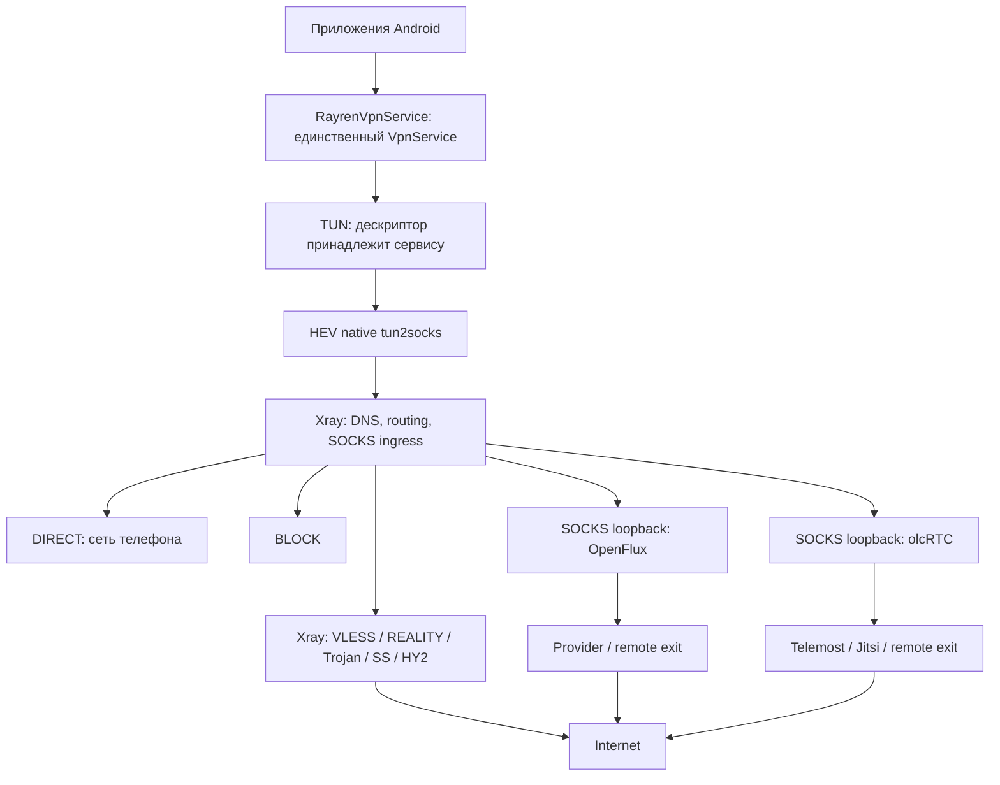

# Rayren Android: архитектура

## Дополнение 0.1.7

Временный фильтр RU-2 удалён из Selection и интерфейса. PersonalSubscription разбирает единый аккаунтный ответ с основной JSON-подпиской и резервными URI, допускает явное пустое состояние отозванного аккаунта и связывает повторный импорт по стабильному account_id только для собственного HTTPS-маршрута. Сохранение использует прежний атомарный SubscriptionUpdate, обновления — существующий WorkManager.

Серверный пилот зарегистрирован отдельным модулем внутри действующей выдачи; основной JSON строится прежним INCY-обработчиком. Бот подтверждает пользователя существующим личным чатом и выдаёт capability-ссылку, а не клиентский Telegram ID. Старый модуль одноразовой привязки оставлен отдельной будущей реализацией.

## Уточнение 0.1.6

BootstrapAddress отделяет числовые IPv4/IPv6 от DNS-имён до обращения к Android DnsResolver. Это общий путь bootstrap для VPN и ProbeService; иначе одиночный профиль с IP мог ошибочно завершаться до проверки транспорта, а балансировщик продолжал работу.

В AUTO ReserveRoutes распознаёт резерв по движку, пометке профиля/подписки и участникам балансировщика. Обычные кандидаты без ошибок текущей сети идут первыми, резерв — после их неудачи, повторные попытки уже ошибавшихся обычных узлов — после резерва. Это заменяет прежнее раннее переключение на другой транспорт после одной неудачи; SMART сохраняет прежнюю стратегию измерений.

## Дополнение 0.1.5

ServerList централизует безопасное удаление, стабильную сортировку измерений и страницы по 50. Настройки списка применяются независимо от конфигурации работающего туннеля. Автопинг ограничен текущей страницей и возрастом результата; обновление при открытии ограничено пятью минутами, фоновое обновление выполняется существующим WorkManager.

Selection перемешивает кандидатов AUTO внутри уровней доступности, сохраняет приоритет проверенного маршрута и раннюю пробу другого транспорта после сбоя. AutoEligibility исключает распознанный RU-2 и содержащий его балансировщик из автоматического выбора.

WhitelistBypass задаёт отдельный каталог доменов, PolicyCompiler создаёт ограниченный этими доменами DNS-маршрут DIRECT. NetworkResolver делает bootstrap DNS отменяемым на API 29+, ограничивает ожидание и число legacy-задач. Нативный контекст HTTP отменяется при остановке/смене маршрута, новый контекст создаётся при следующем запуске. OpenFlux startup имеет сериализованный барьер и очистку позднего результата после отмены.

Первый этап Telegram отделён в integration/telegram: одноразовое подтверждение устройства и разрешение подписок по проверенному пользователю. Это локальная подготовка, не действующая авторизация в приложении.

Дата исследования: 16 октября 2026. Статус: архитектурное ревью завершено, GO для реализации; это не разрешение на публичный production-релиз. Пользователь выбрал GPLv3 и включение всех движков.

## Контекст и границы

Существующий каталог содержит серверные скрипты Rayren, старый BS Scout на v2rayNG, исправленный Veil 0.6 и исследовательские материалы OpenFlux/Ghostlane. Отдельного приложения Rayren не было. Новый проект изолирован в `rayren-android`; сервер, бот, пользователи и форматы `/sub/`, `/json/`, `/incy/`, `/rayren/` не меняются. Их наличие в рабочей папке не доказывает текущее состояние production.

Цель: один Android VPN, один импорт, понятное подключение, несколько движков, настоящий DIRECT с телефона, безопасные обновления. Не цель этой итерации: собственный VPN/криптопротокол, серверный биллинг, одновременное сохранение TCP-сессий при смене внешнего IP, обещания работы у всех операторов.

## Решение

Собственная компактная Kotlin/Compose оболочка и domain-слой. Повторно используется проверенный в исходниках Veil способ сборки Xray + olcRTC + OpenFlux в одну gomobile-библиотеку. Полный UI Veil не копируется: в нём несколько режимов служб и прямые зависимости экранов от глобальных managers, которые усложнят единый lifecycle Rayren. HEV обрабатывает пакеты нативно. Xray является общим маршрутизатором и DNS-движком, а также одним из транспортов.

UI зависит только от состояния приложения и команд controller. TransportEngine получает типизированный профиль, параметры внутреннего listener и SocketProtector. Он предоставляет prepare/start/stop/health/stats/capabilities. Он не владеет Android VPN. Kotlin не копирует каждый пакет.

## Альтернативы

| Вариант | Преимущества | Цена и решение |
|---|---|---|
| HEV + общий Xray router + SOCKS engines | Совместимость Xray JSON, существующая native сборка трёх движков, локальный DIRECT | Дополнительный SOCKS hop; OpenFlux IPv4; выбран |
| sing-box TUN/DNS/router + Xray/OpenFlux/olcRTC | Сильный общий DNS/TUN, Hysteria2 | Четвёртый движок, несколько Go runtimes либо сложное объединение, версии gVisor/Pion; резервный ADR |
| Прямое переключение читателей TUN между движками | Короткий путь OpenFlux packet mode | Различная DNS/routing семантика, лишние JNI copies, сложнее kill switch; отклонён |

## Кто чем владеет

- RayrenVpnService создаёт TUN, notification, network callback и coroutine scope; только он закрывает дескриптор.
- HEV читает TUN и отправляет TCP/UDP общему SOCKS ingress.
- Xray выполняет DNS interception и first-match routing; DIRECT это локальный freedom outbound.
- Controller последовательно управляет transport lifecycle. Одновременный start/stop сериализован; устаревший результат не меняет новый сеанс.
- Собственный UID Rayren исключён из VPN. В режиме allowlist он не включается, в остальных используется disallow. Это системная защита всех служебных сокетов, в том числе путей OpenFlux без protect callback. Где API предоставляет callback, отказ protect должен завершать соединение, а не разрешать его.
- Исключение собственного UID означает, что запросы самой программы являются служебным трафиком. Пользовательские проверки явно отправляются через SOCKS, никогда через обычный HTTP client.

## Переключение и kill switch

TUN удерживается при падении и смене транспорта. Сначала останавливается общий ingress, затем старый transport, затем запускается новый и восстанавливается ingress. Пакеты не получают direct fallback. Существующие TCP-сессии и UDP associations могут разорваться: смена exit не обеспечивает миграцию TCP. Удержание TUN не равно сохранению сессий.

После гибели Android-процесса приложение не может удержать файловый дескриптор. Защита в этот момент требует Android Always-on VPN + Block connections without VPN. UI объясняет это и открывает системные настройки. Явное «Отключить» прекращает VPN; ошибка транспорта оставляет сервис в блокирующем состоянии.

## DNS, IPv6, per-app

Подробности в DNS_AND_ROUTING_DESIGN.md. DNS приложений захватывается внутри TUN. По умолчанию DNS через tunnel, без незаметного fallback на системный resolver. Bootstrap адресов VPN/provider является отдельным control-plane исключением. IPv6, не поддерживаемый транспортом, блокируется; нельзя просто убрать IPv6 route и разрешить ОС обход. Изменение per-app списка требует новой VPN policy и может потребовать переустановки интерфейса; transport switching такого изменения не требует.

## Подписки и секреты

URI/Base64 и legacy JSON преобразуются в типизированные профили. Произвольный Xray JSON не передаётся движку из сети: разрешённые outbounds извлекаются и конфигурация создаётся заново. Rayren Manifest версионируется, ограничивается по размеру/числу записей. Импорт и обновление проходят parse → validate → verify when signed → atomic encrypted persist. Ошибка сохраняет предыдущую конфигурацию.

Android Keystore AES-GCM защищает единый local vault. Backup секретов отключён. Никаких UUID, URL подписки, ключей или полного native exception в диагностике. Введён allowlist диагностических полей.

## Lifecycle, сеть, производительность

Foreground service запускает notification сразу. NetworkCallback отслеживает физическую сеть и captive portal, изменения дают debounce и reconnect. Exponential backoff ограничен; AUTO пробует другие профили после cooldown. Нет проверки каждую секунду и постоянного wake lock. GUI получает Flow snapshots, stats собираются отдельно от health checks.

Масштабирование: один Go runtime, нативный HEV, один активный альтернативный transport. Smart Balance сначала использует недавние замеры, затем ограниченные реальные HTTP проверки. Нельзя открывать десятки Cups/WebRTC сессий ради пинга. Точные RAM/CPU/battery/throughput остаются UNRESOLVED до устройства и тестового exit.

## Стек и структура

Kotlin, Compose Material 3, coroutines/Flow, Gson для разбора с явной validation, OkHttp для HTTPS и явно заданных legacy HTTP подписок, Android Keystore; ручной DI достаточен. Отдельный JVM module `domain` для моделей, parsing, policy, scoring и тестов; Android `app` для UI/storage/service/adapters. Native зависимости собираются отдельно в одну AAR. Room не нужен для небольшого encrypted vault.

minSdk 26. Цель SDK 37 согласно актуальной документации Android 17; локальный SDK manager не находит platform 37, поэтому первая воспроизводимая сборка может использовать 36, что должно быть явно отражено в BUILD_REPORT. Нельзя менять номер SDK только ради заявления о совместимости.

## Gate

GO: packet ownership, embedding, лицензии, routing, DNS и failure model определены по исходникам. До распространения: native build, parser/security/policy tests, APK validation и реальные Android DNS/IPv6/failover тесты. Непроверенный provider остаётся experimental. Полное соответствие ТЗ определяется REQUIREMENTS_STATUS, не количеством экранов.

## Управление и проверки 0.1.2

Смена сервера сохраняет только параметры выбора (mode, selectedId, region), затем увеличивает ревизию маршрута. Цикл VpnService читает свежие профили/настройки, завершает старый транспорт и запускает новый на том же TUN/HEV и локальных портах. Ожидание cooldown прерывается новой ревизией; интерфейс VPN не переустанавливается. Текущие TCP-сессии могут оборваться при смене выхода. Изменение per-app списков остаётся отдельной настройкой с переподключением: Android применяет списки при establish ([документация Android](https://developer.android.com/develop/connectivity/vpn)).

Список пингов использует обычный неэкспортируемый bound Service в процессе `:probe`; VpnService в нём не создаётся. Отдельные Go globals, временные loopback-порты и привязка процесса к физической сети защищают активный маршрут от перезапуска во время проверки. Ключи передаются только внутри приложения через Binder; на диск не записываются. Ответ отправляется после остановки движков. Таймаут отдельного native запроса 3–15 сек; watchdog через 45 сек завершает только процесс проверки, включая зависший native-вызов. Binder death освобождает владение транспортом. RayrenApp не открывает хранилище и не планирует обновления подписок в процессе проверки.

TransportLease в основном процессе сериализует запуск профиля между VPN и проверкой. Для OpenFlux и olcRTC блокировка общая на движок, чтобы не создавать параллельные сеансы провайдеров даже из похожих профилей. Занятый активный профиль проверяется через существующий VPN; другой профиль занятого внешнего движка отмечается BUSY. Xray-профили проверяются независимо. Команда смены сервера завершает текущую отдельную проверку, останавливает очередь и затем меняет выбор.

RussianBypass — явный редактируемый каталог групп: домены и package IDs. Он не определяет гражданство приложения и не отправляет перечень установленных программ наружу. Android PackageManager показывает найденные названия. В режиме INCLUDE автоматические исключения вычитаются из разрешённых; в ALL/EXCLUDE добавляются в disallowed. Собственный UID исключён всегда. .ru/.рф, группы сайтов и свои домены компилируются ниже защиты DNS/IPv6 и пользовательских правил, выше маршрута по умолчанию. Браузеры целиком в каталоге не исключаются.

## Изменения 0.1.3

ServerGroups связывает профили с владельцами-подписками, не раскрывая URL в заголовке. Один профиль может отображаться в нескольких группах с уникальными ключами списка. Ручное обновление обходит ETag для повторного разбора ранее импортированного JSON.

SmartBalance хранит только проверенные proxy outbounds. PolicyCompiler создаёт теги proxy-N, balancerTag, leastPing, observatory и proxy fallback. Прямые маршруты, защита DNS/IPv6 и настройки пользователя сохраняют приоритет; чужие правила не импортируются. Для Xray обычные доменные назначения остаются AsIs, удалённое разрешение выполняется прокси. Для локальных SOCKS-адаптеров внешних движков сохраняется ForceIPv4 через Rayren DNS. Счётчики объединяют proxy и proxy-N.

ProbeReport измеряет свежий HTTPS GET и возвращает только длительности. UI показывает полное время без поправок, журнал — этапы. Уведомление использует VpnNotificationText: стабильный Rayren, маршрут, пинг и распознаваемые LiveBridge скорости KB/s. Подробности/границы — FOLLOWUP_0.1.3.md.

## Изменения 0.1.4

SubscriptionUpdate применяет только успешно загруженную замену источника, сохраняя общие и ручные профили. Pin — локальное поле Subscription; порядок групп меняется без изменения владения профилями. Редактор URL использует защищённый диалог и не сохраняет открытый URL в saved state.

Selection разделяет историю по физической сети и networkGeneration. NetworkCallback отслеживает смену сети/LinkProperties, результаты проверяются guard до принятия. Непроверенный транспорт получает попытку после первого провала другой технологии; SMART формирует до 12 кандидатов с представителями разных движков. Ручное отключение reconnect действует только в MANUAL. Смена маршрута не закрывает TUN.

Conflated Channel будит контроллер на смену сети, RESELECT и PING. Статистика собирается раз в 5 секунд, длительные паузы ждут событие/таймаут без частого опроса. NotificationRefreshGate сравнивает видимый текст, режим и доступность пинга; неизменное уведомление повторяется не чаще минуты. Таймер Home ограничен STARTED lifecycle.
