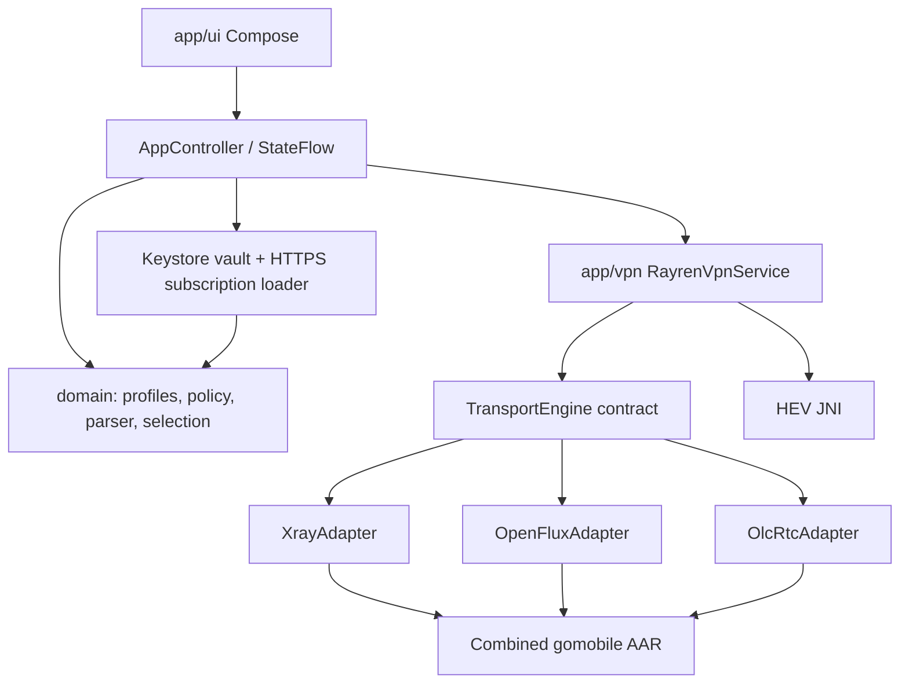

# Dependencies

Domain has no Android/native imports. UI never calls gomobile. Native libraries never create Android services. `docs/research` contains public provenance only; `.research` is an ignored local source/build workspace. No production credential belongs in repository, examples, test fixtures or APK.
